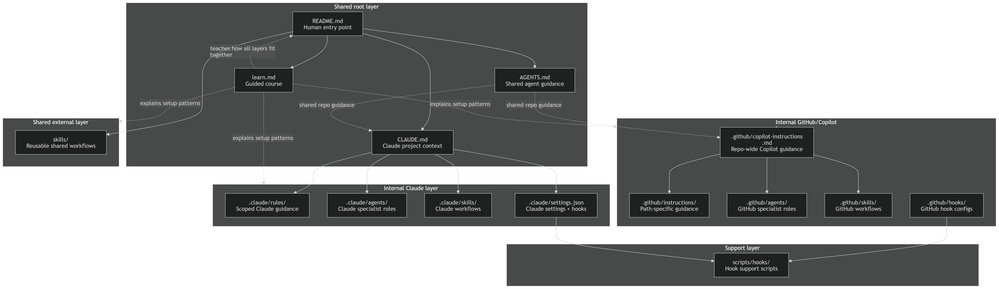

<div align="center">

  

  # AI Repo Structure - Build AI-Ready Repositories

  **A working reference for structuring AI-enabled repositories:**  
  **`AGENTS.md`, `CLAUDE.md`, instructions, custom agents, skills, and hooks, each in the right place.**

  [](https://github.com/IgniteUI/ai-repo-structure)
  [](./LICENSE)
  [](./LEARN.md)
  [](https://igniteui.github.io/ai-repo-structure/)

  [Course](./LEARN.md) · [Docs site](https://igniteui.github.io/ai-repo-structure/) · [Quick start](#quick-start) · [Contributing](./CONTRIBUTING.md)

</div>

---

## Why this exists

Adding AI coding tools to a repo usually starts with one instruction file and grows into a mess:

- one giant instruction file that tries to do every job
- no clear answer to what belongs in `AGENTS.md`, `CLAUDE.md`, rules, agents, skills, or hooks
- Claude Code and GitHub Copilot setups that drift apart or duplicate each other

This repository shows a clean alternative. It is a **template**, a **reference implementation**, and a **learning repo** at the same time: its own AI setup is real, in use, and part of the lesson.

It is for developers building an AI-enabled repo from scratch, teams cleaning up an existing AI setup, and maintainers who want internal AI helpers for review, structure, and documentation.

---

## Which file does which job

| File or folder | Job |
| --- | --- |
| `AGENTS.md` | Shared always-on rules for all coding agents |
| `CLAUDE.md` | Claude-only always-on rules |
| `.github/copilot-instructions.md` | Copilot-only always-on rules |
| `.instructions.md` / `.claude/rules/` | Scoped rules for certain files or folders |
| Custom agents | Specialist roles |
| Skills (`SKILL.md`) | Reusable multi-step workflows |
| Hooks | Small, deterministic actions at known events |

The full decision table, with when to use each one and what not to use it for, is in [LEARN.md](./LEARN.md#decision-table-when-to-use-what).

---

## What's inside

| Layer | Location | For | Contains |
| --- | --- | --- | --- |
| Shared root | [`README.md`](./README.md), [`LEARN.md`](./LEARN.md), [`AGENTS.md`](./AGENTS.md), [`CLAUDE.md`](./CLAUDE.md), [`CONTRIBUTING.md`](./CONTRIBUTING.md) | Humans and all agents | Entry point, course, shared agent rules, Claude rules, contributor workflow |
| Internal Claude | [`.claude/`](./.claude) | Maintainers using Claude Code | A scoped rule, the `learning-repo-maintainer` agent, the `validate-learning-repo` skill, a `SessionStart` hook in `settings.json` |
| Internal GitHub/Copilot | [`.github/`](./.github) | Maintainers using GitHub Copilot | Repo-wide and path-specific instructions, the `learning-repo-maintainer` agent, the `review-learning-repo-pr` skill, an optional `sessionStart` hook for Copilot coding agent |
| Shared skills | [`skills/`](./skills) | Users of the repo and outside agents | [`use-this-repo`](./skills/use-this-repo/SKILL.md) to understand the structure, [`adopt-this-repo`](./skills/adopt-this-repo/SKILL.md) to plan adoption in another project |
| Hook support | [`scripts/hooks/`](./scripts/hooks) | Hook runtimes | Small scripts that give agents session-start context and checks |
| Docs site | [`docs/`](./docs) | Search and browsing | The public [GitHub Pages site](https://igniteui.github.io/ai-repo-structure/) |

The Claude and Copilot layers mirror each other on purpose, so you can compare the same idea in both tools.

<details>
<summary><strong>Show how the layers connect (diagram)</strong></summary>

<br/>



The diagram shows which files explain the repo, which files guide tools, and which folders contain reusable workflows or automation.

</details>

---

## Quick start

Clone the repository:

```bash
git clone https://github.com/IgniteUI/ai-repo-structure.git
```

Then pick a path.

**1. Learn the structure.** Read [LEARN.md](./LEARN.md). Each module explains one file type and gives you a template and a real example from this repo.

**2. Copy the minimal setup.** Most repos only need this to start:

- `README.md`
- `AGENTS.md`
- one always-on file for the tool you use: `CLAUDE.md` or `.github/copilot-instructions.md`

Start from the templates in [Module 2](./LEARN.md#module-2--agentsmd), [Module 3](./LEARN.md#module-3--claudemd), and [Module 8](./LEARN.md#module-8--github-copilot-repo-wide-instructions). Add rules, agents, skills, and hooks only when a real need appears. The [adoption levels](./skills/adopt-this-repo/references/adoption-levels.md) describe when to move from `minimal` to `practical` or `full`.

**3. Let your coding agent plan it.** Point Claude Code, GitHub Copilot, or another agent at the adoption skill:

```text
Follow skills/adopt-this-repo/SKILL.md to create an adoption plan for my project at <path-to-your-repo>.
```

It returns a plan split into must-have, good-to-have, and optional, with what to copy now, adapt later, or skip.

---

## The course

[LEARN.md](./LEARN.md) is a practical course with 14 modules. Every module covers what the file is for, how to write its description, best practices, a **copyable template**, and a **real example** from this repository.

| Area | Modules |
| --- | --- |
| Shared root | [1. README.md](./LEARN.md#module-1--readmemd) · [2. AGENTS.md](./LEARN.md#module-2--agentsmd) |
| Claude | [3. CLAUDE.md](./LEARN.md#module-3--claudemd) · [4. Rules](./LEARN.md#module-4--claude-rules) · [5. Agents](./LEARN.md#module-5--claude-agents) · [6. Skills](./LEARN.md#module-6--claude-skills) · [7. Settings and hooks](./LEARN.md#module-7--claude-settings-and-hooks) |
| GitHub Copilot | [8. Repo-wide instructions](./LEARN.md#module-8--github-copilot-repo-wide-instructions) · [9. Path-specific instructions](./LEARN.md#module-9--github-path-specific-instructions) · [10. Agents](./LEARN.md#module-10--github-agents) · [11. Skills](./LEARN.md#module-11--github-skills) · [12. Coding agent hooks](./LEARN.md#module-12--github-copilot-coding-agent-hooks) |
| Shared | [13. Shared skills](./LEARN.md#module-13--shared-skills) · [14. Hook support scripts](./LEARN.md#module-14--hook-support-scripts) |

It ends with [a good rollout order](./LEARN.md#a-good-rollout-order) and [common mistakes](./LEARN.md#common-mistakes).

---

## Core ideas

1. **AI files should have clear roles.** Not everything belongs in one giant instruction file.
2. **Internal and external AI layers should be separate.** Maintainer AI (`.claude/`, `.github/`) is different from user-facing AI (`skills/`).
3. **Each file type does a different job.** Rules and instructions are guidance, agents are specialized roles, skills are reusable workflows, and hooks are optional deterministic automation for supported runtimes.
4. **Hooks stay small and low-risk.** Here they only orient an agent at session start: Claude receives repo context, and Copilot coding agent can run a quick check of core files.
5. **A template repo should still feel real.** Meaningful files and realistic relationships teach more than an empty folder tree.

---

## Repository structure

<details>
<summary><strong>Show the full repository tree</strong></summary>

```text
ai-repo-structure/
├─ .claude/                                      # Internal Claude layer for repo maintainers
│  ├─ agents/                                    # Claude subagents specialized for this repo
│  │  └─ learning-repo-maintainer.md             # Claude agent that maintains repo structure and learning quality
│  ├─ rules/                                     # Always-on or scoped Claude guidance for this repo
│  │  └─ repo-learning.md                        # Rule that keeps the repo accurate as a teaching/learning repo
│  ├─ skills/                                    # Claude skills for repeatable internal maintainer workflows
│  │  └─ validate-learning-repo/                 # Claude skill that audits whether the repo still matches what it teaches
│  │     ├─ assets/                              # Reusable output resources for the skill
│  │     │  └─ report-template.md                # Template for reporting validation results
│  │     ├─ references/                          # Supporting docs the skill reads while working
│  │     │  └─ checklist.md                      # Checklist for validating structure, naming, and teaching quality
│  │     ├─ scripts/                             # Helper scripts used by the skill
│  │     │  └─ check-required-files.sh           # Script that checks whether required repo files exist
│  │     └─ SKILL.md                             # Main Claude skill definition and workflow instructions
│  └─ settings.json                              # Claude project settings; needed here because Claude project hooks live here
│
├─ .github/                                      # Internal GitHub/Copilot layer for repo maintainers
│  ├─ agents/                                    # Custom GitHub Copilot agents for this repo
│  │  └─ learning-repo-maintainer.agent.md       # GitHub-side maintainer agent for repo structure and learning content
│  ├─ instructions/                              # Path-specific Copilot instructions
│  │  └─ learning-content.instructions.md        # Copilot guidance for README, AGENTS, CLAUDE, and other teaching content
│  ├─ hooks/                                     # GitHub/Copilot workspace hook configs
│  │  └─ session-start-check.json                # Official sessionStart hook config for validating core repo guidance
│  ├─ skills/                                    # GitHub Copilot skills for repeatable maintainer workflows
│  │  └─ review-learning-repo-pr/                # GitHub skill for reviewing PRs that change the repo's learning structure
│  │     ├─ assets/                              # Reusable review output resources
│  │     │  └─ review-template.md                # Template for writing PR review findings
│  │     ├─ references/                          # Supporting docs for the review skill
│  │     │  └─ review-checklist.md               # Checklist for reviewing structure, naming, and correctness
│  │     ├─ scripts/                             # Helper scripts used by the review skill
│  │     │  └─ list-learning-files.sh            # Script that lists learning-related files changed in a PR
│  │     └─ SKILL.md                             # Main GitHub skill definition and PR review workflow
│  └─ copilot-instructions.md                    # Main repo-wide GitHub Copilot instructions
│
├─ skills/                                       # External/shared skills for users of the repo and outside agents
│  ├─ README.md                                  # Overview of the available shared skills
│  ├─ use-this-repo/                             # Shared skill for understanding the repo structure and layers
│  │  ├─ assets/                                 # Reusable templates for user-facing outputs
│  │  │  └─ adoption-plan-template.md            # Template for suggesting how someone should adopt this repo
│  │  ├─ references/                             # Supporting docs for understanding the repo
│  │  │  └─ repo-map.md                          # Explanation of the repo layers and what each one is for
│  │  ├─ scripts/                                # Helper scripts for external/shared usage
│  │  │  └─ quickstart-check.sh                  # Script that checks whether the expected starter structure exists
│  │  └─ SKILL.md                                # Main shared skill definition for understanding the repo
│  └─ adopt-this-repo/                           # Shared skill for adopting this AI structure into another project
│     ├─ assets/                                 # Reusable templates for adoption output
│     │  └─ adoption-plan-template.md            # Template for producing a practical adoption plan
│     ├─ references/                             # Supporting docs for adoption decisions
│     │  ├─ repo-map.md                          # Summary of the repo layers and their jobs
│     │  ├─ adoption-levels.md                   # Minimal, practical, and full adoption levels
│     │  └─ copy-vs-adapt.md                     # What to copy, adapt, rename, or skip
│     ├─ scripts/                                # Helper scripts for adoption checks
│     │  └─ quickstart-check.sh                  # Optional script for checking a target repo's starter structure
│     └─ SKILL.md                                # Main shared skill definition for adoption planning
│
├─ docs/                                         # Public documentation site for GitHub Pages and search indexing
│  ├─ _config.yml                                # GitHub Pages / Jekyll site configuration
│  ├─ index.html                                 # Interactive landing page (AI Repo Map)
│  ├─ styles.css                                 # Styles for the landing page
│  ├─ app.js                                     # Script that renders the landing page content
│  ├─ read.md                                    # Markdown overview page of the repository
│  ├─ repo-structure.md                          # Page explaining the repository structure and each main layer
│  ├─ claude-vs-copilot.md                       # Page comparing the Claude-specific and GitHub Copilot-specific parts
│  ├─ getting-started.md                         # Page showing how to use this repo as a starter, reference, or learning repo
│  ├─ googlecad1e2aef0d47fd8.html                # Google Search Console verification file
│  ├─ robots.txt                                 # Search engine crawler instructions for the public docs site
│  └─ sitemap.xml                                # List of site pages to help search engines discover them
│
├─ public/                                       # Static assets used by the docs
│  └─ assets/
│     ├─ igniteui.svg                            # Repository svg
│     └─ mermaid-diagram.png                     # Diagram of how the AI layers connect
│
├─ scripts/                                      # Shared repo utility scripts
│  └─ hooks/                                     # Helper scripts used by Claude and GitHub/Copilot hooks
│     ├─ claude-session-context.sh               # Emits repo context for Claude SessionStart
│     └─ github-session-start-check.sh           # Bash sessionStart check for GitHub Copilot coding agent hooks
│
├─ src/                                          # Project source area; currently the AI Repo Map demo page
│  ├─ index.html                                 # Small HTML shell for the demo page
│  ├─ styles.css                                 # Styles for the AI Repo Map layout
│  └─ app.js                                     # Small script that renders the repo map content
│
├─ AGENTS.md                                     # Shared agent-facing instructions for coding agents working in the repo
├─ CLAUDE.md                                     # Main Claude-specific project guidance
├─ CONTRIBUTING.md                               # Contributor workflow guidance for keeping the repo accurate and aligned
├─ LEARN.md                                      # Course for understanding and copying the system
├─ LICENSE                                       # MIT license
└─ README.md                                     # Main human entry point
```

</details>

---

## Contributing

Contributions that keep the repo accurate and practical are welcome. Read [CONTRIBUTING.md](./CONTRIBUTING.md) first. The main rule is that the repo must teach exactly the structure it contains.

If this repo helped you decide where an AI instruction belongs, a ⭐ helps other developers find it.

## License

[MIT](./LICENSE)
